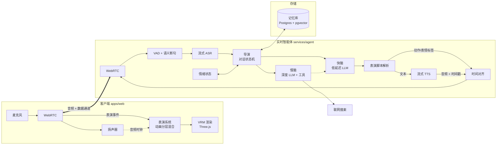

# 02 系统架构

## 1. 总览



三个设计决定贯穿全局：

1. **全链路流式**：ASR、LLM、TTS 都是流式，任何一环不等上游"说完"
2. **一份表演脚本**：LLM 输出的不是纯文本，而是带表演标注的脚本，语音和动作都从它派生，天然同步
3. **身体不依赖大脑**：待机、倾听、即时反应由客户端与轻量规则驱动，不等 LLM —— 用身体掩盖延迟

## 2. 语音链路

### 2.1 方案选择：级联 vs 端到端语音模型

| | 级联 (ASR→LLM→TTS) | 端到端语音模型 |
|---|---|---|
| 延迟 | 800ms 左右，需精心优化 | 300–500ms，天然低 |
| 人格/记忆可控性 | 高，文本层可任意注入 | 较弱 |
| 声线定制 | 可用任意 TTS / 自训练声线 | 受限于厂商预置音色 |
| 动作标注 | LLM 文本流里直接带 | 难拿到对齐的结构化输出 |
| 中文/日语角色音 | 可选专门的二次元 TTS | 受限 |

**决定：级联为主**。本项目的核心（人格、记忆、定制声线、动作同步）都依赖文本层的控制力。延迟差距用下面的手段补。架构上把语音链路封装成接口，日后端到端模型成熟可替换。

### 2.2 延迟预算（目标 P50 800ms）

| 环节 | 预算 | 手段 |
|---|---|---|
| 断句判定 | 200–300ms | 语义断句模型，而非固定静音阈值 |
| ASR 定稿 | ~50ms | 流式识别，断句时文本已基本就绪 |
| LLM 首 token | 250–350ms | 快速档模型、提示词缓存、精简上下文 |
| TTS 首包 | 150–200ms | 流式 TTS，按子句切分送入 |
| 网络 + 缓冲 | ~100ms | WebRTC，就近部署 |

进一步的手段：

- **推测式生成**：断句置信度中等时就开始让 LLM 生成，若用户继续说则丢弃
- **身体先行**（规范 T2）：断句判定的同时立即下发"准备开口"事件 —— 视线对上、吸气、嘴微张。主观延迟大幅降低
- **填充语是角色行为而非补丁**：慢脑工作时，快脑自然地说"嗯…等一下，这个我想想"

### 2.3 轮次管理（导演）

导演是一个对话状态机，管理 `待机 / 倾听 / 思考 / 说话 / 被打断` 的切换：

- **打断**：她说话时检测到用户出声 → 区分附和声（"嗯""对"，不停）与真打断（停止 TTS、截断已播放位置、记录"说到哪被打断"进上下文）
- **附和**：用户长句中，在语义停顿点下发非语言附和（点头）或短语音附和（"嗯"），不进入完整应答流程
- **沉默**：双方沉默超过阈值，由导演按情绪和关系决定：主动开口 / 做自己的事 / 继续等
- **上下文真实性**：写入对话历史的是**实际播放出去**的内容，不是 LLM 生成的全文

## 3. 大脑

### 3.1 快慢双脑

- **快脑**：每一轮都走。低延迟模型，负责口语应答、情绪反应、表演标注。上下文 = 人设（缓存）+ 情绪状态 + 检索到的记忆 + 近期对话
- **慢脑**：按需触发（知识性问题、需要搜索、需要翻找久远记忆）。更强的模型 + 工具，异步运行，结果注入快脑的下一句。期间快脑维持对话
- **后台脑**：会话外运行，做记忆巩固、准备下次开场话题（见 03 文档）

模型层做成可替换接口。项目走国内线：快脑用国内模型的低延迟档，慢脑与后台用旗舰档，具体型号在 M0 以延迟实测和人设稳定性试听决定，候选见 [06 供应商候选](06-vendors.md)。

### 3.2 表演脚本格式

快脑的输出是带内联标注的流式文本：

```
[gaze:away][expr:thinking]嗯……[pause:400]这个我没有把握。
[gaze:user][emo:curious+0.2]不过可以查。[gesture:hand_on_chin]店长是从哪里听来的？
```

- 标注词表是**封闭集合**，由协议定义（表情、视线、手势、姿态、停顿、情绪增量）
- 解析器流式剥离标注：文本送 TTS，标注送对齐模块
- 标注密度由提示词约束（约每句 0–2 个），多了反而假
- 兜底：LLM 没标注时，由规则根据情绪状态 + 韵律自动补动作

### 3.3 知识

"知识渊博"由三层提供：模型自身知识（多数情况足够）→ 慢脑联网搜索（时效性内容）→ 人设知识库（角色"专业领域"的深度内容，可选）。关键不在知道多少，而在**怎么说** —— 用角色的口吻讲，会兴奋、会跑题、会嫌你基础差。

## 4. 表演系统（客户端）

### 4.1 形象方案：3D VRM

| | 3D (VRM) | Live2D |
|---|---|---|
| 全身动作 | 任意骨骼动画、可动捕、可程序化 | 受限于预制参数，全身大动作困难 |
| 二次元观感 | 卡通渲染可以很好，上限取决于模型质量 | 最贴近原画 |
| 资产成本 | VRoid 可快速出原型；精品需定制 | 立绘 + 拆分 + 绑定，改动作成本高 |
| 生态 | 开放标准，Web/Unity/Unreal 通用 | 专有 SDK |

**决定：3D VRM + 卡通渲染**。"全身像 + 实时动作反馈"是需求里的硬约束，只有骨骼动画能支撑。渲染层抽象成接口，保留日后接 Live2D 或 Unity 客户端的可能。

### 4.2 动画分层

从底到顶叠加混合，每层独立运行：

| 层 | 内容 | 驱动源 | 依赖服务端？ |
|---|---|---|---|
| L0 生命感 | 呼吸、眨眼、微眼动、重心转移 | 程序化 + 噪声 | 否 |
| L1 基础姿态 | 站姿、抱臂、叉腰等 | 情绪状态 | 低频同步 |
| L2 注意力 | 视线、头部朝向 | 对话状态 + 标注 | 事件 |
| L3 倾听 | 点头、歪头、微表情 | 用户语音韵律 + 导演 | 事件 |
| L4 说话 | 口型、韵律头动、手势 | TTS 音频/时间戳 + 标注 | 事件 |
| L5 表情 | 面部混合形状 | 情绪 + 标注 | 事件 |
| L6 特殊动作 | 完整的一次性动作 | 标注 | 事件 |

- **口型**：优先用 TTS 返回的音素/时间戳映射 viseme；没有则客户端做音频驱动的口型分析
- **手势**：动作库（VRMA 片段，带"重音帧"元数据），按标注选取并把重音帧对齐到语音重音。远期可换成语音驱动的生成式手势模型
- **程序化优先**：视线、头动、呼吸、姿态过渡都用程序化 + IK，避免"循环播放动画"的机械感
- **时钟**：一切以客户端**音频播放时钟**为准，保证口型和动作与听到的声音对齐

### 4.3 表演事件协议（`packages/protocol`）

服务端通过 WebRTC 数据通道下发，示意：

```jsonc
// 状态类：低频、幂等
{ "type": "state", "dialog": "listening", "emotion": { "valence": 0.2, "arousal": 0.6 } }

// 即时类：立刻执行
{ "type": "cue", "action": "prepare_to_speak" }
{ "type": "cue", "action": "backchannel", "variant": "nod" }

// 时间轴类：绑定到某段语音的播放时间
{ "type": "timeline", "utterance_id": "u_42", "events": [
    { "t": 0,    "expression": "annoyed", "gaze": "away" },
    { "t": 1150, "gesture": "arms_cross", "gaze": "user" }
  ],
  "visemes": [ { "t": 0, "v": "a" }, { "t": 90, "v": "i" } ]
}

// 中断类
{ "type": "interrupt", "utterance_id": "u_42" }
```

## 5. 技术选型

标注"候选"的需要在 M0 实测后定，评判标准是延迟与表现力，不是名气。

| 模块 | 选择 | 说明 |
|---|---|---|
| 客户端 | TypeScript + Vite + Three.js + three-vrm | Web 优先，零安装；后续可用 Tauri/Electron 套壳做桌面常驻 |
| 实时传输 | WebRTC（候选：LiveKit） | 自带回声消除、抖动缓冲、数据通道 |
| 智能体框架 | Python（候选：LiveKit Agents / Pipecat） | 提供流式管线和打断处理的骨架，核心的导演逻辑自己写 |
| VAD / 断句 | Silero VAD + 语义断句模型 | |
| ASR | 国内线候选：豆包流式识别、阿里 Paraformer 实时版；自托管备选 SenseVoice·FunASR | 需要中文流式 + 低延迟 |
| LLM | 国内线候选：豆包、通义千问等（快脑用低延迟档，慢脑用旗舰档） | 接口可替换；人设提示词走缓存 |
| TTS | 国内线候选：豆包语音合成大模型、MiniMax、CosyVoice；远期自训练声线 | **全项目最关键的选型**，决定"像不像人"的一半 |
| 记忆库 | Postgres + pgvector | 一个库解决结构化 + 向量 + 全文 |
| 模型资产 | 原型用 VRoid Studio；正式版定制 | |
| 动作资产 | VRMA；来源：动捕库重定向 + 手 K 关键动作 | |

## 6. 部署形态

- v1：单用户 / 小规模自托管。一个 agent 进程服务一个会话，Postgres 一个实例
- 配置化：所有模型供应商通过环境变量与配置切换，密钥不入库
- 远期可选：本地推理档（本地 ASR/TTS + 云端 LLM）以降低成本与延迟
