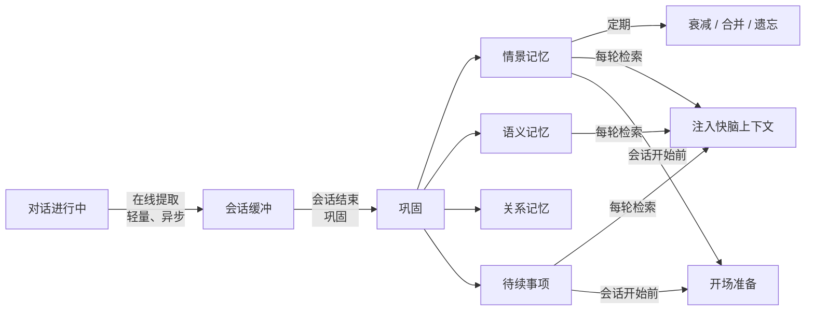

# 03 记忆系统

原作里 Amadeus 的本质就是"记忆数据 + 运行它的系统"。记忆不是附加功能，是人格的载体。

## 1. 设计目标

- **她记得**：事实（你叫什么、做什么）、经历（上周聊了什么）、情感（你提到那件事时很难过）
- **她像人一样记**：重要的记得牢，琐事会淡忘；回忆带着模糊感（"你好像说过…是吧？"），而不是数据库式的精确复述
- **她会用**：记忆改变她的行为 —— 主动提起、不重复问、称呼和态度随关系变化
- **用户可控**：能看到她记了什么，能让她忘掉

## 2. 记忆分层

| 层 | 内容 | 生命周期 | 存储 |
|---|---|---|---|
| 工作记忆 | 当前对话的最近若干轮 + 本次会话滚动摘要 | 会话内 | 内存 |
| 情景记忆 | 一段段"发生过的事"：时间、话题、摘要、双方情绪、重要度 | 长期，会衰减 | 表 + 向量 |
| 语义记忆 | 关于用户的稳定事实与偏好：身份、人际关系、喜恶、习惯 | 长期，可被更新/推翻 | 结构化表 + 向量 |
| 关系记忆 | 亲近度、关系阶段、共同的梗、称呼、她对用户的印象 | 长期，慢变 | 结构化 |
| 待续事项 | 未完结的话题、用户提到的未来事件（"周五面试"）、她许下的承诺 | 到期/完结后归档 | 结构化，带时间 |
| 自我记忆 | 她自己说过的观点、编过的"经历"、对事物的态度 | 长期 | 表 + 向量 |

自我记忆容易被忽略但对一致性（规范 C1）至关重要：她上周说讨厌香菜，这周就不能说喜欢。

## 3. 记忆的生命周期



### 3.1 写入

- **在线**（会话中，异步，不阻塞对话）：只标记"值得记"的片段和明显的事实，写入会话缓冲
- **巩固**（会话结束后，后台脑，可以慢、可以用强模型）—— 类比睡眠：
  1. 把会话切成若干情景，写摘要，打重要度（情绪强度、新颖度、与用户核心事项的相关度）
  2. 提取/更新语义事实；与旧事实冲突时保留历史（"以前在 A 公司，上月跳槽到 B"），不是直接覆盖
  3. 更新关系状态与她对用户的印象
  4. 登记待续事项及其时间点
  5. 记录她自己本次表达过的观点

### 3.2 遗忘

- 情景记忆有强度值：`强度 = 重要度 × 时间衰减 × 被回忆次数加成`。被提起一次就被强化
- 低强度的情景逐步合并成更粗的摘要（"那阵子你常聊工作上的烦心事"），细节丢失但印象保留
- 语义事实不衰减，只会被更新
- 用户要求"忘掉这件事" → 真删除，不是软标记

### 3.3 检索

每轮对话在断句前后并行触发，必须在延迟预算内（目标 ≤ 100ms，超时则本轮不带）：

- **常驻上下文**（不检索，每轮都在）：用户核心档案、关系状态、近期待续事项、最近 1–2 次会话的摘要
- **动态检索**：以最近几句对话为查询，混合打分 = 向量相似度 + 关键词 + 时间近因 + 记忆强度
- **深度回忆**：用户明确问起久远的事（"我们第一次聊的是什么来着"）→ 交给慢脑多步检索，快脑先说"唔…让我想想"

### 3.4 回忆的表达

检索到的记忆带**置信度与清晰度**注入提示词，让她的表达与之匹配：

- 强记忆 → 直接说："你上周五不是面试吗"
- 弱记忆 → 带模糊感："你之前好像提过…是你妹妹吧？"
- 没检索到 → 坦然地不记得："诶，有这回事？"

这比"永远精确"更像人，同时也给检索错误留了自然的台阶。

## 4. 主动回忆

每次会话开始前，后台准备一份开场素材：

- 到期的待续事项（面试是昨天 → 该问结果了）
- 距上次聊天的时长（三小时 vs 两周，态度不同）
- 上次结束时的情绪（不欢而散 → 开场要有所体现）
- 当前时间（深夜、清晨、周末）

会话中，导演在沉默或话题自然结束时，可以从待续事项和相关情景里挑一个话头。频率要克制 —— 每次会话至多一两次主动提起旧事，多了像在背档案。

## 5. 数据模型（草案）

```
episodes       (id, user_id, started_at, ended_at, summary, topics[], user_emotion,
                self_emotion, importance, strength, recall_count, embedding)
facts          (id, user_id, subject, predicate, value, confidence, valid_from,
                valid_to, source_episode_id, embedding)
relationship   (user_id, affinity, stage, nickname_for_user, impression, shared_refs[])
open_threads   (id, user_id, kind, description, due_at, status, source_episode_id)
self_memories  (id, topic, stance, said_at, source_episode_id, embedding)
transcripts    (episode_id, turn_index, speaker, text, t_start, t_end, interrupted)
```

原始转写保留，以便日后改进巩固算法时可以重跑。

## 6. 隐私

- 记忆库属于用户：提供查看、编辑、删除、整体导出与清空
- 默认不保存原始音频，只保存转写文本
- 自托管优先；数据库加密静态存储
- 记忆内容只用于本用户的对话，不跨用户、不用于训练

## 7. 评测

- **召回**：构造多会话脚本（埋入事实 → 若干会话后提问），测事实召回率与错误记忆率
- **更新**：事实被推翻后，是否使用新值
- **主动性**：待续事项到期后的首次会话，是否自然提起
- **一致性**：跨会话重复询问她的观点，答案是否稳定
